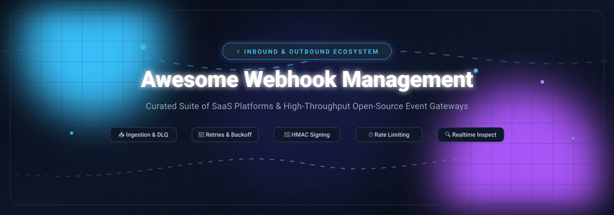

# ⚡ Awesome Inbound & Outbound Webhook Management

  

  <strong>Curated ecosystem of enterprise SaaS platforms, high-throughput event gateways, and developer tools for reliable webhook delivery, ingestion, HMAC security, retries, rate limiting, and real-time inspection.</strong>

  <a href="#-table-of-contents">Table of Contents</a> •
  <a href="#-sector-overview--market-dynamics">Sector Overview</a> •
  <a href="#-saashosted-platforms">SaaS Platforms</a> •
  <a href="#-open-source-github-projects">Open-Source Projects</a> •
  <a href="#-star-history">Star History</a> •
  <a href="#-support--sponsor">Support</a>

---

## 📑 Table of Contents

- [🌐 Sector Overview & Market Dynamics](#-sector-overview--market-dynamics)
- [☁️ SaaS/Hosted Platforms](#-saashosted-platforms)
- [💻 Open-Source GitHub Projects](#-open-source-github-projects)
  - [🚀 High-Throughput Gateways & Webhook Services](#-high-throughput-gateways--webhook-services)
  - [🔄 Event-Driven Engines & Automation Orchestrators](#-event-driven-engines--automation-orchestrators)
  - [🌐 Tunneling, Port Forwarding & Edge Exposure](#-tunneling-port-forwarding--edge-exposure)
  - [🔍 Request Inspection, Mocking & Local Testing](#-request-inspection-mocking--local-testing)
  - [📜 Specifications & Cryptographic Signature Libraries](#-specifications--cryptographic-signature-libraries)
- [📈 Star History](#-star-history)
- [🤝 How to Contribute](#-how-to-contribute)
- [💖 Support & Sponsor](#-support--sponsor)
- [⚠️ Disclaimer](#-disclaimer)

---

## 🌐 Sector Overview & Market Dynamics

The global **Event-Driven Architecture (EDA) & API Integration** market is estimated at **$4.2 billion to $8.2 billion** and is expanding at an impressive **18.4% CAGR** toward an anticipated **$31.5+ billion**. Within this landscape, specialized **Webhook Management** represents a high-growth developer infrastructure segment driven by the universal transition toward asynchronous microservices, composable architectures, and event-driven APIs.

The webhook management ecosystem exhibits **moderate fragmentation with specialized concentration**: enterprise workflow automation and API hubs (such as Celonis/Make, Zapier, and Postman) command multi-billion-dollar scale, while purpose-built developer gateways (like Svix, Hookdeck, and Convoy) rapidly gain high-velocity adoption by solving specialized inbound ingestion, HMAC signing, exponential backoff retries, and consumer-facing debugging portals.

---

## ☁️ SaaS/Hosted Platforms

The following hosted SaaS platforms provide managed webhook dispatching, event ingestion gateways, traffic inspection, and workflow automation. The table is ordered by company valuation and enterprise scale (descending).

| SaaS Platform 🛠️ | Company Size (Valuation / Revenue) 🏢 | Key Webhook Capabilities ⚙️ | Pricing (Paid Tiers) 💳 | Free Tier / Free Trial Limits 🎁 |
| :--- | :--- | :--- | :--- | :--- |
| **[Make (Celonis)](https://make.com)** | **$13.0B Valuation** *(Parent Celonis; $400M+ Rev)* | Visual automation module providing instant custom webhook triggers, JSON parsing, error handling, and scheduled HTTP event routing. | Starts at **$9.00/mo** *(annual)* or **$10.59/mo** *(monthly)* for Core Plan (10,000 ops/mo). | **Free forever plan**: 1,000 operations/mo, 2 active scenarios, 15-minute minimum execution interval, 5 MB file size. |
| **[Postman Webhooks](https://postman.com)** | **$5.6B Valuation** *($300M+ ARR)* | Enterprise API platform enabling webhook-triggered collection runs, automated monitor endpoints, and incoming payload payload debugging. | Starts at **$9.00/user/mo** *(Solo, annual)* or **$19.00/user/mo** *(Team, annual)*. | **Free forever plan**: 1 user seat, unlimited local runs, 1,000 API monitoring calls/mo, and 50 AI credits/mo. |
| **[Zapier Webhooks](https://zapier.com)** | **$5.0B Valuation** *($310M+ ARR)* | Multi-step integration connector enabling custom inbound catch webhooks and outbound HTTP POST/PUT/GET actions across 6,000+ apps. | Starts at **$19.99/mo** *(annual)* or **$29.99/mo** *(monthly)* for Professional Plan (750 tasks/mo, unlocks Webhooks by Zapier). | **Free plan has 100 tasks/mo** (2-step Zaps only; Webhooks by Zapier requires Professional paid plan or a 14-day full-feature trial). |
| **[Pipedream](https://pipedream.com)** | **$150M+ Valuation** *(Est.; $20M+ Series A)* | Developer-first integration platform offering instant catch-webhook URLs, serverless Node.js/Python event workflows, and request inspector. | Starts at **$99.00/mo** *(annual)* or **$150.00/mo** *(monthly)* for Startup Plan (100 external users, 10,000 credits/mo). | **Free developer tier**: Full development/testing access across 3,000+ connectors, unlimited test runs, restricted to development environments. |
| **[Courier Webhooks](https://courier.com)** | **$100M+ Valuation** *(Est.; $57M Funding)* | Unified notification API supporting outbound webhook dispatching channels alongside multi-channel push, SMS, and email messaging. | Pay-as-you-go starting at **$0.005 per send** *(Business tier; no base monthly fee)*. | **Free forever plan**: Up to 10,000 sends/month included across all channels, SDKs, CLI, and template studio. |
| **[Svix](https://svix.com)** | **$35M–$50M Valuation** *(Est.; $13.1M Funding)* | Enterprise webhooks-as-a-service providing outbound dispatching, automated exponential retries, HMAC cryptographic signatures, and embeddable customer App Portals. | Starts at **$20.00/mo** *(Basic Plan)* or **$490.00/mo** *(Professional Plan with 99.9% SLA & 7-day retention)*. | **Free forever plan**: Up to 50,000 messages/month, 50 messages/sec throughput, embeddable consumer webhook portal. |
| **[Hookdeck](https://hookdeck.com)** | **$10M–$20M Valuation** *(Est.; $3M Funding)* | High-reliability event gateway and webhook infrastructure platform for inbound ingestion, queuing, rate limiting, and dead-letter recovery. | Starts at **$39.00/mo** *(Team Plan, 7-day retention)*; Outpost outbound starts at **$10 per 1M events** (pay-as-you-go). | **Free tier**: 10,000 events/month, 3-day data retention, 1 team seat (and Outpost managed tier includes 50,000 free events). |
| **[Convoy (Cloud)](https://getconvoy.io)** | **$5M–$10M Valuation** *(Est.; $937K Funding)* | Cloud-native bidirectional webhook gateway for handling high-volume incoming and outgoing webhooks with static IPs, filtering, and retries. | Starts at **$99.00/mo** *(Cloud Pro, 25 events/sec throughput limit)* or **$499.00/mo** *(Cloud Premium)*. | **14-day free trial** of Cloud Pro/Premium (no credit card required); self-hosted open-source version is permanently free. |
| **[Webhook.site](https://webhook.site)** | **Indie SaaS (~$360K ARR)** *(Profitable / Bootstrapped)* | Instant online developer utility to capture, inspect, transform, and programmatically test incoming HTTP requests and webhook payloads. | Starts at **$9.00/mo** *(Basic, $90/year)* or **$19.00/mo** *(Pro)* for permanent URLs and custom actions. | **Free tier**: Up to 50 requests/emails per URL, basic header/payload inspection, URLs expire after 7 days. |
| **[RequestBin](https://pipedream.com/requestbin)** | **Division of Pipedream** | Instant cloud-hosted HTTP request collector for capturing, debugging, and inspecting webhook event payloads in real time. | Included within Pipedream platform tiers (starting at **$99.00/mo** for production workspaces). | **Free forever**: Instant public and private request bins with real-time inspection stream (up to 500 requests per bin). |

---

## 💻 Open-Source GitHub Projects

A comprehensive collection of open-source projects for self-hosting webhook gateways, event routers, reverse tunnels, and payload inspection. All repositories are sorted by GitHub Stars_Counts (descending), each featuring a social-style badge directly linked to its stargazers page.

| Repository 📂 | GitHub_Stars ⭐ | Description 📝 | Primary Language 💻 |
| :--- | :--- | :--- | :--- |
| **[n8n](https://github.com/n8n-io/n8n)** |  | Fair-code workflow automation platform with extensive inbound webhook triggers, HTTP nodes, payload transformations, and event routing logic. | TypeScript |
| **[frp](https://github.com/fatedier/frp)** |  | High-performance reverse proxy written in Go to expose local webhook consumers behind NAT and firewalls to the public internet securely. | Go |
| **[PocketBase](https://github.com/pocketbase/pocketbase)** |  | Open-source backend in Go featuring real-time subscriptions, embedded SQLite, and built-in event-driven webhook triggers for record changes. | Go |
| **[Novu](https://github.com/novuhq/novu)** |  | Open-source notification infrastructure enabling multi-channel delivery, outbound webhook dispatching, digest engines, and subscriber event queues. | TypeScript |
| **[Directus](https://github.com/directus/directus)** |  | Open-source data platform and Headless CMS featuring granular real-time event triggers, custom inbound webhook actions, and outbound payload dispatches. | TypeScript |
| **[Hasura GraphQL Engine](https://github.com/hasura/graphql-engine)** |  | Instant GraphQL & REST APIs with resilient asynchronous Event Triggers, reliable webhook delivery, retries, and database change data capture (CDC). | Haskell / Go |
| **[Activepieces](https://github.com/activepieces/activepieces)** |  | Open-source low-code business and developer automation platform offering webhook triggers, code execution steps, and reliable HTTP action nodes. | TypeScript |
| **[ngrok (OSS v1)](https://github.com/inconshreveable/ngrok)** |  | Classic open-source introspected reverse proxy creating secure tunnels from public endpoints directly to local webhook development environments. | Go |
| **[Vector](https://github.com/vectordotdev/vector)** |  | Ultra-fast, high-performance observability data pipeline and event router written in Rust supporting HTTP webhook ingestion, buffering, and delivery. | Rust |
| **[localtunnel](https://github.com/localtunnel/localtunnel)** |  | Node.js client and server to easily expose local HTTP webhook listeners to the world without firewall configurations or port forwarding. | JavaScript |
| **[Windmill](https://github.com/windmill-labs/windmill)** |  | Open-source developer platform that instantly turns Python, TypeScript, Go, and Bash scripts into scalable, auto-generated webhook endpoints and workflows. | Rust / Svelte |
| **[Apprise](https://github.com/caronc/apprise)** |  | Universal push notification and webhook alert library in Python supporting dozens of messaging services, custom webhook POSTs, and payload formatting. | Python |
| **[cloudflared](https://github.com/cloudflare/cloudflared)** |  | Cloudflare Tunnel daemon connecting local web servers and webhook endpoints directly to Cloudflare without opening public inbound ports. | Go |
| **[Gotify](https://github.com/gotify/server)** |  | Simple, lightweight self-hosted server for sending and receiving push notifications and webhook messages via real-time WebSockets and HTTP APIs. | Go |
| **[adnanh/webhook](https://github.com/adnanh/webhook)** |  | Lightweight configurable incoming webhook server in Go that captures HTTP requests, parses headers/JSON, and executes shell scripts with arguments. | Go |
| **[bore](https://github.com/ekzhang/bore)** |  | Modern, minimalist zero-configuration TCP tunnel written in Rust that exposes local webhook servers to remote public ports efficiently. | Rust |
| **[Redpanda Connect](https://github.com/redpanda-data/connect)** |  | High-performance stream processor (formerly Benthos) in Go with HTTP webhook inputs, stateless payload mapping (Bloblang), retries, and multi-sink fanout. | Go |
| **[Mockoon](https://github.com/mockoon/mockoon)** |  | Lightweight open-source local API mock designer and webhook tester for inspecting payloads, simulating latency, and validating schemas. | TypeScript |
| **[Supabase Realtime](https://github.com/supabase/realtime)** |  | Elixir-based distributed server for listening to database changes, broadcasting events via WebSockets, and firing external webhook triggers. | Elixir |
| **[Webhook.site (OSS)](https://github.com/webhooksite/webhook.site)** |  | Self-hostable open-source engine of Webhook.site for inspecting, intercepting, testing, and debugging incoming HTTP payloads in real-time. | PHP / Vue |
| **[CloudEvents Spec](https://github.com/cloudevents/spec)** |  | Vendor-neutral CNCF specification for describing event data in common formats to simplify event declaration and webhook routing across cloud providers. | Markdown |
| **[Soketi](https://github.com/soketi/soketi)** |  | Ultra-fast, resilient Pusher-compatible WebSocket and event broker server written in C++/uWebSockets.js with built-in webhook event reporting. | TypeScript / C++ |
| **[Svix Core](https://github.com/svix/svix-webhooks)** |  | Enterprise-grade open-source webhook sending microservice in Rust with cryptographic HMAC signing, backoff retry schedules, and consumer UI portal. | Rust |
| **[Convoy](https://github.com/frain-dev/convoy)** |  | Cloud-native high-throughput bidirectional webhook gateway in Go for managing millions of inbound/outbound events with retries, rate limits, and static IPs. | Go |
| **[Argo Events](https://github.com/argoproj/argo-events)** |  | Event-driven workflow automation framework for Kubernetes that triggers Kubernetes objects, CI/CD jobs, and serverless tasks on incoming webhooks. | Go |
| **[Standard Webhooks](https://github.com/standard-webhooks/standard-webhooks)** |  | Open-source specification and multi-language SDKs (Go, Rust, Python, TypeScript, Java) for standardized webhook HMAC signing and timestamp verification. | Multi-language |
| **[Knative Eventing](https://github.com/knative/eventing)** |  | Kubernetes-native event routing and management system offering CloudEvents routing, declarative broker-trigger delivery, filters, and dead-letter sinks. | Go |
| **[Hook0](https://github.com/hook0/hook0)** |  | Open-source webhooks-as-a-service platform built in Rust for multi-tenant applications to emit secure, verifiable, and observable outbound webhooks. | Rust |
| **[Outpost](https://github.com/hookdeck/outpost)** |  | Open-source outbound webhook delivery service and event gateway designed to deliver events to destination APIs and message brokers reliably. | Go |
| **[CloudEvents Go SDK](https://github.com/cloudevents/sdk-go)** |  | Official Go implementation and SDK for CloudEvents, providing HTTP transport bindings, JSON serialization, and webhook event handlers. | Go |
| **[Smee.io](https://github.com/probot/smee.io)** |  | Open-source webhook payload delivery client and service that captures public webhooks and forwards them seamlessly over Server-Sent Events (SSE) to localhost. | JavaScript |
| **[Hookdeck CLI](https://github.com/hookdeck/hookdeck-cli)** |  | Open-source developer CLI to intercept, listen, inspect, and forward incoming webhooks directly to local web servers during development. | Go |

---

## 📈 Star History

---

## 🤝 How to Contribute

Contributions, suggestions, and corrections are warmly welcomed! 🌟

1. 🍴 **Fork** this repository.
2. 🌿 **Create a new branch** (`git checkout -b feature/add-new-webhook-tool`).
3. 📝 **Add or edit entries** in `README.md` following the tabular formatting and standards.
4. 🔍 Ensure the links are accurate, descriptions are factual, and pricing/star information is verified.
5. 🚀 **Commit your changes** (`git commit -m 'Add <ToolName> to webhook management list'`).
6. 📬 **Open a Pull Request** with a brief summary of what you've added or updated.

---

## 💖 Support & Sponsor

Thank you for exploring this curated repository! If you find this project valuable for your architecture research, benchmarking, or production implementations, please consider supporting its ongoing maintenance:

- ⭐ **Star this repository** to help fellow developers discover it.
- 🍴 **Fork and share** it with your engineering team, platform architects, and API communities.
- ☕ **Sponsor the maintainer** or buy a coffee via the [GitHub Sponsors Dashboard](https://github.com/sponsors/ishandutta2007).

Your encouragement and support keep this developer resource updated, accurate, and community-driven! 🙏

---

## ⚠️ Disclaimer

- This is a **community-curated index** created for educational, benchmarking, and architectural research purposes — inclusion does not imply official endorsement.
- All webhook infrastructure in production must enforce strict security baselines: **HMAC-SHA256 signature verification**, **timestamp validation** (to prevent replay attacks), **IP allowlisting**, and **TLS encryption**.
- Self-hosted open-source gateways require dedicated persistence queues (e.g., Redis, Kafka, PostgreSQL), dead-letter queues (DLQ), and alerting monitors for enterprise workloads.

---

  Built with ❤️ for backend engineers, API architects, and platform teams worldwide.

